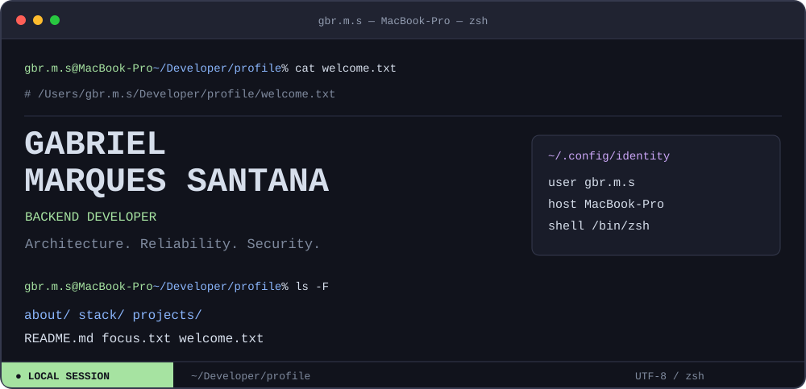
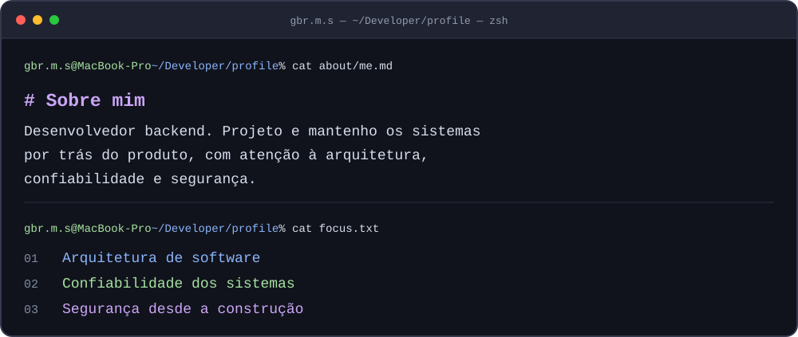
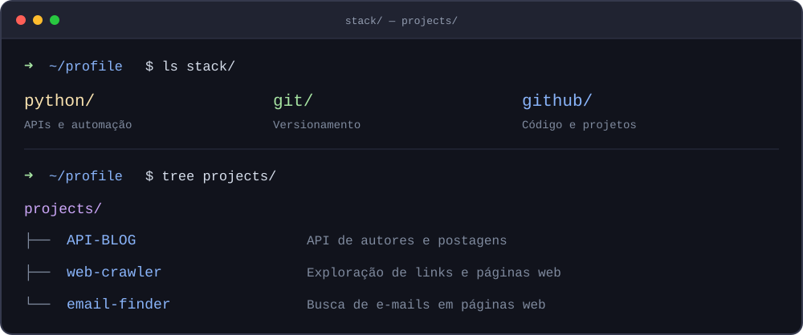
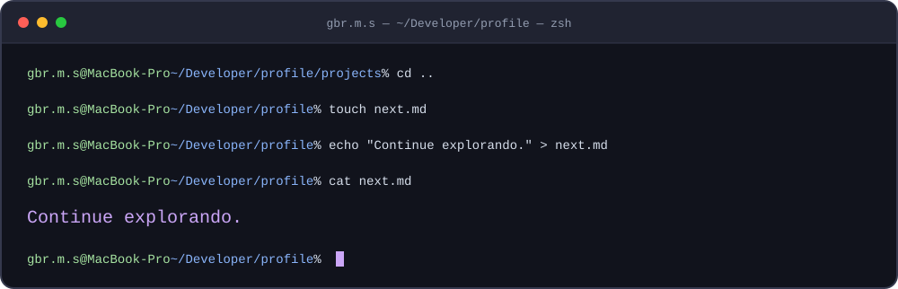

<!-- Janela e comandos são uma apresentação visual, não um shell interativo. -->


<details>
<summary><code>open README.md</code> — índice do workspace</summary>

```text
~/profile
├── about/
│   └── me.md
├── stack/
│   ├── python/
│   ├── git/
│   └── github/
├── projects/
│   ├── API-BLOG/
│   ├── web-crawler/
│   └── email-finder/
├── focus.txt
└── next.md
```

</details>



<details>
<summary><code>cat about/me.md</code> — versão em texto</summary>

Sou **Gabriel Marques Santana**, desenvolvedor backend. Projeto e mantenho os sistemas por trás do produto, com atenção à **arquitetura, confiabilidade e segurança**.

</details>



### `cd projects/`

[`./API-BLOG`](https://github.com/gsantanaoffsec/API-BLOG) — API de autores e postagens.  
[`./web-crawler`](https://github.com/gsantanaoffsec/web-crawler) — Exploração de links e páginas web.  
[`./email-finder`](https://github.com/gsantanaoffsec/email-finder) — Busca de e-mails em páginas web.

<details>
<summary><code>cat stack/README.md</code> — ferramentas e foco</summary>

**Ferramentas:** Python · Git · GitHub  
**Foco:** Backend · APIs · Arquitetura de software · Segurança · Automação

</details>



<p align="center">
  <a href="https://github.com/gsantanaoffsec?tab=repositories"><code>ls ~/repositories →</code></a>
  &nbsp; · &nbsp;
  <a href="https://github.com/gsantanaoffsec?tab=stars"><code>cat ~/bookmarks →</code></a>
</p>
