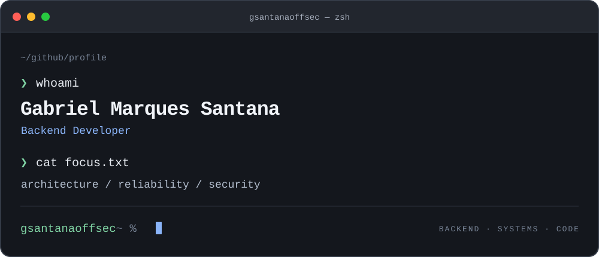

  

### `01 / about`

Sou **Gabriel Marques Santana**, desenvolvedor backend. Projeto e mantenho os sistemas por trás do produto, com atenção à **arquitetura, confiabilidade e segurança**.

Por aqui, compartilho projetos de APIs, automação e exploração da web com Python.

### `02 / toolbox`

`Python` · `Git` · `GitHub`

**Áreas de interesse**
`Backend` · `APIs` · `Arquitetura de software` · `Segurança` · `Automação`

<!-- Atualize a lista acima com as tecnologias que você usa atualmente. -->

### `03 / projects`

| Projeto | O que você encontra |
| :--- | :--- |
| [API-BLOG](https://github.com/gsantanaoffsec/API-BLOG) | API para autores e postagens. |
| [web-crawler](https://github.com/gsantanaoffsec/web-crawler) | Exploração de links e requisições a páginas web. |
| [email-finder](https://github.com/gsantanaoffsec/email-finder) | Busca de endereços de e-mail em páginas web. |

[Ver todos os repositórios →](https://github.com/gsantanaoffsec?tab=repositories)

---

<code>gsantanaoffsec ~ %</code>

